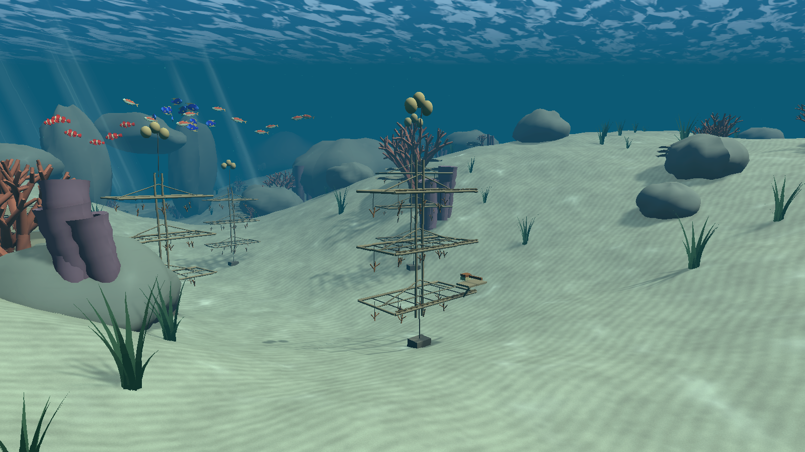
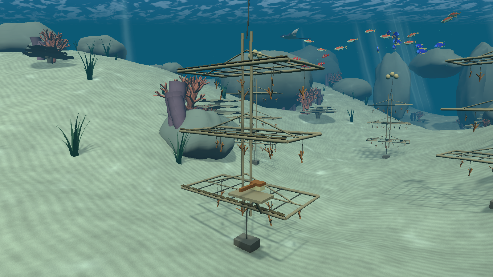
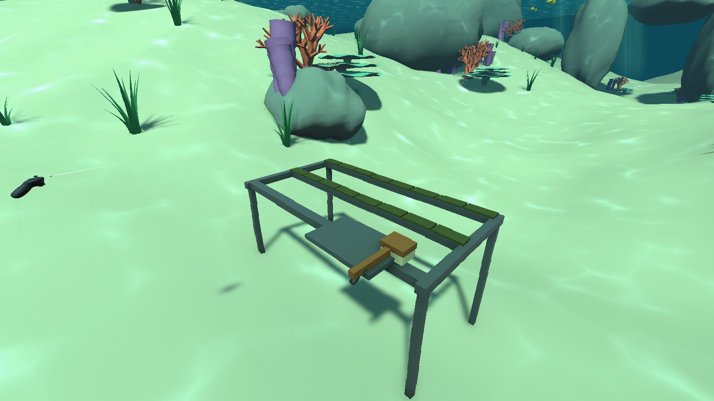
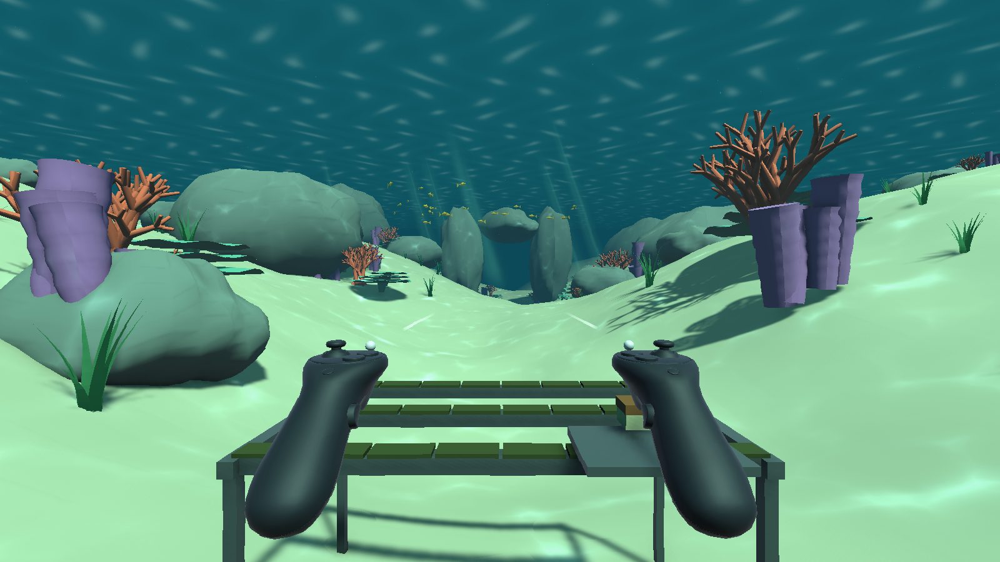
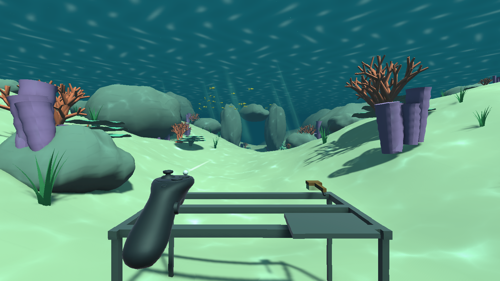

# Reefkeeper — underwater prototype

Unity **6.3 LTS / 6000.3.19f1**, Universal Render Pipeline, XR Interaction Toolkit **3.3.2**. Open the `Reefkeeper` folder in Unity Hub, then open `Assets/Reefkeeper/Scenes/ShallowReef.unity` and press Play. The saved scene starts at the nursery rack with the official XR Interaction Simulator active. No headset is required for this mode.



Milestone 01: Windows build succeeds; movement math and runtime movement/collision checks pass. Three offscreen scene renders were captured for visual review (HUD is not part of those renders). These are procedural prototype assets; underwater materials and art can be replaced independently.

Milestone 02: imported URP-WaterShaders with its original subgraph GUIDs, configured Unity 6 fullscreen color/depth rendering, and applied its caustics to reef materials. Windows shader compilation and runtime movement/collision checks pass; three underwater views were rendered and reviewed. Headset/XR support remains untested.

Milestone 03: added a winding sand channel, raised banks and dunes, with a saved mesh collider; introduced a bilingual Editor art panel for lighting, materials and terrain parameters. Windows build and runtime checks, including descent onto the uneven seabed, pass. The palette and placeholder models remain ready for the user's art direction.

Milestone 04: added Unity's XR Interaction Simulator, underwater XR Origin movement, a grabbable brush and a nursery rack with 24 cleanable patches. The Windows build and both runtime suites pass: simulated swimming/braking, keyboard grip and release, brush following, contact-based cleaning, completion, reset and mode switching. Screenshots below are engine renders with the HUD omitted. Headset and Rokoko input remain untested.

Milestone 05: imported Quaternius's seven animated fish models with separate URP materials and reusable prefabs. Three small-fish schools and one manta ray now swim through the saved reef scene. Windows build, fish runtime checks and the XR interaction regression pass. Validation covers actual skinned vertex deformation, looping animation, path motion, seabed clearance and all 24 rack patches. Also removed the starter rig's 1 mm movement cutoff, which discarded slow XR motion at high frame rates, and made the opt-in input check work in hidden windows. The existing scene palette and nursery layout are preserved for further art direction.

Milestone 06: used the supplied photographic mood board to shift the water toward blue, soften caustics, introduce fine sand/ripple texture and replace the table-shaped rack with a three-tier coral nursery. The nursery has slender stems, open lattice trays, suspended branching fragments, buoyancy floats and seabed tethers. Its 24 cleanable patches sit along the three front rims; three additional trees establish the nursery setting. Quaternius fish models, materials and animations retain their existing style. The Windows build and XR interaction checks pass, including all 24 patches, completion and reset; three art views were rendered and visually reviewed.

Milestone 07: brightened the underwater palette with slightly warm daylight, lighter shadows and a subtle green tint near the sand. The water ceiling now uses irregular animated reflection patches and a brighter overhead color; its fog blending preserves those highlights. Surface reflection strength and ripple scale are editable material properties. The Windows build and shader compilation pass, and three matching art views were rendered for visual review. This pass changes lighting, grading and materials; the nursery geometry and Quaternius fish assets are unchanged.



Earlier milestone 04 interaction views:



| Before cleaning | After cleaning |
| --- | --- |
|  |  |

## XR simulator and rack cleaning

The official simulator drives tracked head/controller input. The brush is an `XRGrabInteractable`; cleaning uses bristle contact and swept distance against 24 algae patches. Holding the brush still, waving it in the air, or moving it while unheld does not clean the rack. Clean patches expose the underlying rack; the HUD reports total progress.

| Input | Action |
| --- | --- |
| Tab | Cycle between body/FPS and device manipulation modes |
| `[` / `]` | Select the left / right controller for manipulation |
| Mouse | Rotate the active head/controller; right-click toggles mouse capture |
| WASD, Q / E | Move the body in FPS mode, or the selected controller in device mode |
| Shift / B | Boost / brake while swimming in FPS mode |
| Hold G | Grip with the selected controller; release G to drop |
| F5 | Restore dirty patches and return the brush to its tray |
| F2 | Switch between XR simulation and the original desktop swimmer |

Start by aiming the right controller at the brush on the tray, then hold **G**. In device mode, move the brush with **WASD + Q/E**; rotate it until the bristles face down, touch a dirty crossbar and sweep sideways. Keep G held while brushing. The simulator's own on-screen panel exposes additional controls. Repeated bracket presses can switch device types; this prototype is configured and tested for controller simulation, not optical hand tracking.

The simulator remains explicitly included in Windows builds. Hardware XR/OpenXR provider setup, stereo rendering, headset performance, headset comfort and Rokoko live input are not validated. The screen-space HUD is for the laptop demo. Keyboard simulation and recorded/synthetic poses must not be presented as live glove tracking.

## Desktop controls (F2)

| Input | Action |
| --- | --- |
| Mouse | Look |
| WASD | Swim relative to view direction |
| Space / C | Rise / descend |
| Shift + movement | Sprint / stronger fin kick |
| Right mouse button or X | Active brake; overrides propulsion |
| Release movement | Coast with water drag |
| R | Reset to the starting point |
| Esc / left click | Release cursor / resume |

No gravity, head bob, camera roll or sprint FOV changes in desktop swimming. Change the public settings on **Diver / desktop input → DiveMotor** to tune the feel. `ReefXRSwim` moves the XR Origin with its own collider in simulator FPS mode; independent controller positioning remains the official simulator's responsibility.

## Editing the look and terrain

Open the **Art controls** panel from the **Reefkeeper** menu with `ShallowReef` open and Play stopped. This panel edits the actual scene lighting, fog, shared grading profile and materials; there is no runtime script that overwrites your art choices.

- Water color, visibility, sunlight, exposure and saturation preview immediately. Enable Scene view effects/fog/post-processing, or use Game view, to see the complete look.
- Select a material button to edit its normal Inspector, including Tint, Main Texture and Caustic Color. These are shared materials; duplicate and assign a material to a particular object if it should have its own look.
- Open `Assets/Reefkeeper/Generated/Water.mat` to adjust **Daylight through water**, **Broken sky reflections**, **Reflection strength** and **Ripple scale**. A smaller ripple scale makes broader patches. This lightweight ceiling shader gives an underwater impression of the surface; it does not simulate refraction of above-water objects.
- Adjust bank height, dunes, channel depth and detail, then use the apply-terrain button. This replaces only the seabed mesh/collider and moves registered props by the change in ground elevation; it preserves their placement offsets, materials and object identities. Undo is supported. Grounded prop references live on the seabed's `ReefSeabed` component; register new prop roots without also registering their children.
- Use the save-materials-and-scene button to save everything. Edits made during Play are disabled in this panel. **Create or rebuild shallow reef** is the original full generator and resets the scene; avoid it when working on your own art/layout. **BuildWindows** builds the saved scene without regenerating it.

The seabed is a mesh with smooth sand banks, dunes and a winding trough, not Unity Terrain/Landscape. The current models and flat textures are still placeholders; these tools prepare the scene for the user's realistic art direction rather than making the placeholder art photorealistic.

## Current scope

- A procedurally authored shallow reef with animated caustics, coral, limestone, a distant arch, fish, seagrass, particles and a water ceiling.
- Underwater caustics and subtle fullscreen distortion from aniruddhahar's MIT-licensed URP-WaterShaders. The original Shader Graphs are preserved; scene-specific materials and Unity 6 renderer configuration live in ReefSceneBuilder. Adjust `Generated/UnderwaterDistortion.mat` (`_Distortion`, currently 0.002) to change or disable distortion; rebuilding resets generated settings.
- View-relative swimming, boost, drag, active braking, collisions, a surface limit and an exploration boundary.
- Small depth/speed display and keyboard hints.
- Editable source assets and a reproducible scene builder. Generated assets live in `Assets/Reefkeeper/Generated`; save a copy of the scene before rebuilding if you have edited it by hand.

The current nursery uses simple project-authored geometry based on the supplied reference photographs. Select **WORKSHOP / coral nursery maintenance → Nursery tree / interactive** to edit the working tree; additional trees live under **NURSERY / suspended coral trees**. Keep the interaction components/contact points when replacing its visual meshes. The hanging fragments are decorative; placing nursery fragments is the next interaction. Swimming motion capture and a current-meter prop remain optional later additions.

## Animated fish

Quaternius's CC0 Animated Fish Pack supplies seven rigged models and swimming clips. The scene uses 26 small fish across three species plus one manta ray. Their animation phases and speeds vary, and `ReefFishSchool` moves each group around an editable loop while maintaining clearance above the seabed. These are ambient paths; obstacle avoidance, predator behavior and a full Boids simulation are not implemented.

- Select **REEF / Quaternius animated fish** in the Hierarchy, then one of its school children. Move that child to shift the route; adjust **Orbit**, **Angular Speed** and **Height Variation** in its Inspector.
- Reusable prefabs, separate species materials and animation controllers live in `Assets/Reefkeeper/Generated/AnimatedFish`. Dolphin, shark and whale prefabs are included as optional assets and are not placed in this nursery scene.
- Original FBX files and their license live in `Assets/ThirdParty/QuaterniusAnimatedFish`. The previous procedural school is disabled in the scene and can be restored.
- Environment candidates are listed in [the stylized reef asset shortlist](docs/STYLIZED_REEF_ASSETS.zh-CN.md); those environment packs have not been imported.

## Mocap capture while the loaner gloves are available

Keep the original Rokoko recordings and ask the hardware desk which export permission is available. Export animation with finger bones (FBX suitable for Unity when available), together with the actor/rig and calibration information. Record slow and natural-speed takes, with a neutral lead-in and lead-out.

Suggested clips: relaxed hand, empty-hand fist/open, brush grip, repeated brushing, brush release, coral-fragment pinch, place and release, optional instrument grip/button press. Use the same prop grip placement each take. Record left/right consistently; name takes with hand, action and speed. Glove finger capture does not imply tracked arm or world-position motion: preserve the distinction when reviewing assets.

Recorded clips should remain reusable without the gloves; interaction events will be separate from hardware adapters. Today's live glove input and any recorded animation playback must be identified honestly in the demonstration.

## Validation

**Reefkeeper → Validate swimming math** checks speed limits, diagonal normalization, coasting, brake priority and drag across frame rates. The command-line runtime smoke check also exercises actual CharacterController collision, descent onto the uneven seabed and the surface limit, and captures four rendered views:

```text
Reefkeeper.exe -reef-smoke <absolute-output-directory> -screen-width 1600 -screen-height 900 -windowed
```

Build with `Reefkeeper.Editor.ReefSceneBuilder.BuildWindows` through Unity's `-executeMethod`, or the normal Windows Build Profiles workflow. Outputs are local under `Reefkeeper/Builds/Windows` and are not committed.

The opt-in XR check uses simulated keyboard actions for swimming, controller translation, grip and release, then replays precise tracked-controller poses to sweep each dirt patch. It checks stationary contact, air strokes, unheld motion, completion, reset and switching modes, and captures an overview, a brush close-up and before/after images:

```text
Reefkeeper.exe -reef-xr-smoke <absolute-output-directory> -screen-width 1600 -screen-height 900 -windowed
```

The fish check verifies actual skinned mesh deformation over time, looping clips, path motion, supported URP materials and sampled seabed clearance. It captures portraits of all four placed species and a habitat view:

```text
Reefkeeper.exe -reef-fish-smoke <absolute-output-directory> -screen-width 1600 -screen-height 900 -windowed
```

For repeatable art review, `-reef-art-capture <absolute-output-directory>` saves three engine renders: nursery overview, frame detail and the reef with fish. These offscreen views omit the HUD and simulator controller models. The local mood-board photographs remain reference material under the ignored `artifacts/moodboard` directory; they are not packaged as game textures.

## Credits

Unity's bundled Universal 3D template supplies the URP render settings. Reef geometry, movement, interface and supporting shaders were authored during this hackathon with Codex assistance. Underwater Shader Graphs are by **aniruddhahar**, [URP-WaterShaders](https://github.com/aniruddhahar/URP-WaterShaders), MIT, pinned to `1d18105ab76f894e3187d32bb4e412dbcb35df2c`. Source, license and integration notes are in `Reefkeeper/Assets/ThirdParty/URP-WaterShaders`; the license is also copied alongside Windows builds.

XR rig, controller models, input actions and simulator assets come from Unity's **XR Interaction Toolkit 3.3.2** samples, under the Unity Companion License; see `Reefkeeper/Assets/Samples/XRI-LICENSE.md`. Sample controller materials are overridden with project URP materials. The underwater reef and nursery props remain project-authored placeholders.

Animated fish are by **Quaternius**, [LowPoly Animated Fish](https://quaternius.itch.io/lowpoly-animated-fish), CC0 1.0. Original files were downloaded from [the creator's OpenGameArt release](https://opengameart.org/content/animated-fish). Their license and provenance are preserved in `Assets/ThirdParty/QuaterniusAnimatedFish`; the license is also copied alongside Windows builds.
