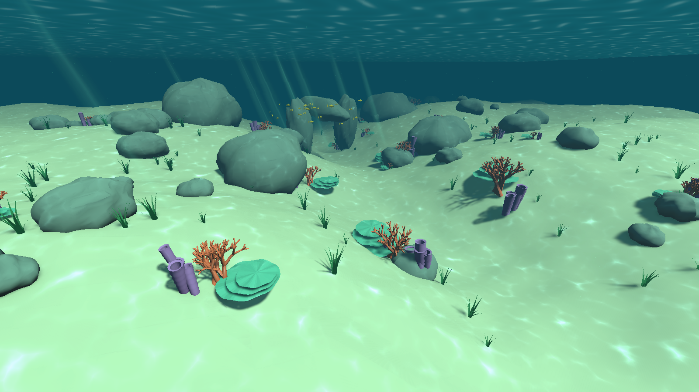

# Reefkeeper — underwater prototype

Unity **6.3 LTS / 6000.3.19f1**, Universal Render Pipeline. Open the `Reefkeeper` folder in Unity Hub, then open `Assets/Reefkeeper/Scenes/ShallowReef.unity` and press Play. If the scene has not been generated yet, choose **Reefkeeper → Create or rebuild shallow reef** in the Editor menu.



Milestone 01: Windows build succeeds; movement math and runtime movement/collision checks pass. Three offscreen scene renders were captured for visual review (HUD is not part of those renders). These are procedural prototype assets; underwater materials and art can be replaced independently.

Milestone 02: imported URP-WaterShaders with its original subgraph GUIDs, configured Unity 6 fullscreen color/depth rendering, and applied its caustics to reef materials. Windows shader compilation and runtime movement/collision checks pass; three underwater views were rendered and reviewed. Headset/XR support remains untested.

Milestone 03: added a winding sand channel, raised banks and dunes, with a saved mesh collider; introduced a bilingual Editor art panel for lighting, materials and terrain parameters. Windows build and runtime checks, including descent onto the uneven seabed, pass. The palette and placeholder models remain ready for the user's art direction.

## Controls

| Input | Action |
| --- | --- |
| Mouse | Look |
| WASD | Swim relative to view direction |
| Space / C | Rise / descend |
| Shift + movement | Sprint / stronger fin kick |
| Right mouse button or X | Active brake; overrides propulsion |
| Release movement | Coast with water drag |
| R | Reset to the starting point |
| Esc / left click | Release cursor / resume |

No gravity, head bob, camera roll or sprint FOV changes. Change the public settings on **Diver / desktop input → DiveMotor** to tune the feel. This is currently a desktop prototype, not a validated VR build. Glove capture and live input are not connected yet.

## Editing the look and terrain

Open the **Art controls** panel from the **Reefkeeper** menu with `ShallowReef` open and Play stopped. This panel edits the actual scene lighting, fog, shared grading profile and materials; there is no runtime script that overwrites your art choices.

- Water color, visibility, sunlight, exposure and saturation preview immediately. Enable Scene view effects/fog/post-processing, or use Game view, to see the complete look.
- Select a material button to edit its normal Inspector, including Tint, Main Texture and Caustic Color. These are shared materials; duplicate and assign a material to a particular object if it should have its own look.
- Adjust bank height, dunes, channel depth and detail, then use the apply-terrain button. This replaces only the seabed mesh/collider and moves registered props by the change in ground elevation; it preserves their placement offsets, materials and object identities. Undo is supported. Grounded prop references live on the seabed's `ReefSeabed` component; register new prop roots without also registering their children.
- Use the save-materials-and-scene button to save everything. Edits made during Play are disabled in this panel. **Create or rebuild shallow reef** is the original full generator and resets the scene; avoid it when working on your own art/layout. **BuildWindows** builds the saved scene without regenerating it.

The seabed is a mesh with smooth sand banks, dunes and a winding trough, not Unity Terrain/Landscape. The current models and flat textures are still placeholders; these tools prepare the scene for the user's realistic art direction rather than making the placeholder art photorealistic.

## Current scope

- A procedurally authored shallow reef with animated caustics, coral, limestone, a distant arch, fish, seagrass, particles and a water ceiling.
- Underwater caustics and subtle fullscreen distortion from aniruddhahar's MIT-licensed URP-WaterShaders. The original Shader Graphs are preserved; scene-specific materials and Unity 6 renderer configuration live in ReefSceneBuilder. Adjust `Generated/UnderwaterDistortion.mat` (`_Distortion`, currently 0.002) to change or disable distortion; rebuilding resets generated settings.
- View-relative swimming, boost, drag, active braking, collisions, a surface limit and an exploration boundary.
- Small depth/speed display and keyboard hints.
- Editable source assets and a reproducible scene builder. Generated assets live in `Assets/Reefkeeper/Generated`; save a copy of the scene before rebuilding if you have edited it by hand.

Next: cleaning coral racks with a brush and placing nursery fragments. Swimming motion capture is optional polish after the interaction loop works. A current-meter prop is an optional later interaction.

## Mocap capture while the loaner gloves are available

Keep the original Rokoko recordings and ask the hardware desk which export permission is available. Export animation with finger bones (FBX suitable for Unity when available), together with the actor/rig and calibration information. Record slow and natural-speed takes, with a neutral lead-in and lead-out.

Suggested clips: relaxed hand, empty-hand fist/open, brush grip, repeated brushing, brush release, coral-fragment pinch, place and release, optional instrument grip/button press. Use the same prop grip placement each take. Record left/right consistently; name takes with hand, action and speed. Glove finger capture does not imply tracked arm or world-position motion: preserve the distinction when reviewing assets.

Recorded clips should remain reusable without the gloves; interaction events will be separate from hardware adapters. Today's live glove input and any recorded animation playback must be identified honestly in the demonstration.

## Validation

**Reefkeeper → Validate swimming math** checks speed limits, diagonal normalization, coasting, brake priority and drag across frame rates. The command-line runtime smoke check also exercises actual CharacterController collision, descent onto the uneven seabed and the surface limit, and captures four rendered views:

```text
Reefkeeper.exe -reef-smoke <absolute-output-directory> -screen-width 1600 -screen-height 900 -windowed
```

Build with `Reefkeeper.Editor.ReefSceneBuilder.BuildWindows` through Unity's `-executeMethod`, or the normal Windows Build Profiles workflow. Outputs are local under `Reefkeeper/Builds/Windows` and are not committed.

## Credits

Unity's bundled Universal 3D template supplies the URP render settings. Reef geometry, movement, interface and supporting shaders were authored during this hackathon with Codex assistance. Underwater Shader Graphs are by **aniruddhahar**, [URP-WaterShaders](https://github.com/aniruddhahar/URP-WaterShaders), MIT, pinned to `1d18105ab76f894e3187d32bb4e412dbcb35df2c`. Source, license and integration notes are in `Reefkeeper/Assets/ThirdParty/URP-WaterShaders`; the license is also copied alongside Windows builds. No downloaded third-party models, textures or sound clips are currently used.
